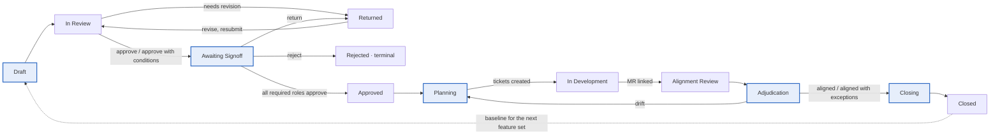
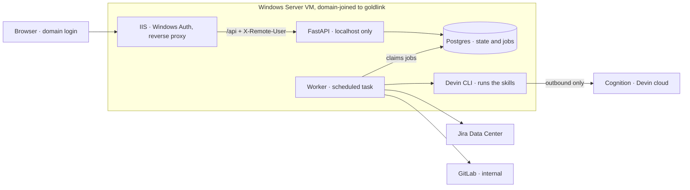

# Proposal Pipeline — Specification and Build Plan

Draft v0.1 · October 29, 2026 · Joe Rinaldi

This is a Markdown export of the working document. Edit here or there; keep them in step by re-exporting when the doc changes materially.

## 1. Purpose and principles

Proposal Pipeline is a web application that runs the Digital Architecture Team's proposal-to-implementation workflow, which today is operated by hand through Devin CLI. The app takes over the operator's job: it stores every artifact, runs the architect's stage skills unchanged, enforces human gates with real identities, creates Jira items from approved plans, and links GitLab merge requests for alignment review and adjudication. It closes the loop by generating the carry-forward baseline that seeds the next feature set.

Scope: unclassified environment only, team scale (tens of users, a handful of proposals a month). Hosted on one domain-joined Windows Server VM.

Principles

1. The architect's skills and templates are the review logic. The app supplies inputs and stores outputs. It does not rewrite the rules.
2. AI recommends. Humans decide. Every gate records who decided, when, and why.
3. Integrations are deterministic code. The AI never improvises a Jira or GitLab call.
4. Postgres is the system of record for everything the app produces. Structured results drive the screens; markdown artifacts are rendered from them, one row per version, never overwritten.
5. Everything is versioned: proposal versions, review runs, and the skill-and-template bundle that produced each result.
6. Least privilege. An AI stage receives only the files it needs. No integration token or database credential enters an AI session.

## 2. Workflow

A proposal passes through thirteen states, five human gates, and two loops. The AI runs between gates; nothing moves past a gate without a named person's decision.



Shaded boxes are human gates.

The main flow runs left to right then back along the bottom row. Review failures and signoff returns loop to Draft; adjudicated drift loops to Planning; the closed cycle's baseline seeds the next feature set's Draft.

| State | Who acts | What happens | Exit |
| --- | --- | --- | --- |
| Draft | Submitter | Uploads or pastes a proposal. App checks template conformance. If nonconforming, Stage 1 reformats it, preserving content and leaving gaps visible. Submitter reviews, edits, and submits. | Submit → In Review |
| In Review | Worker | Stage 2 runs the checklist. Result stored as checks, conditions, and recommendation. | Needs revision → Returned. Approve or Approve with conditions → Awaiting Signoff |
| Returned | Submitter | Sees the gap list. Edits create a new version. Resubmit runs Stage 2 in re-review mode with the prior review attached. | Resubmit → In Review |
| Awaiting Signoff | Signoff roles | Each required role records Approve, Approve with conditions, Return, or Reject with notes. | All approve → Approved. Any Return → Returned. Any Reject → Rejected |
| Rejected | Human only | Terminal. The AI never recommends this. | None |
| Approved | Worker | Conditions carried. Plan drafting job queued. | → Planning |
| Planning | PM or Tech Lead | AI drafts epics and stories from the proposal, requirements, and conditions. Human edits the preview. Required Jira fields validated. On approval, code creates items parent-first and records keys. | Created → In Development |
| In Development | Developers | External work. Developer links a merge request in the app. | MR linked → Alignment Review |
| Alignment Review | Worker | Clone MR at head SHA. Stage 4 runs with proposal, review, signoff record, ticket plan, and prior adjudicated review if any. Citations validated against the clone. | Stored → Adjudication |
| Adjudication | Tech Lead and Architecture Reviewer | Each item shows the AI recommendation pre-selected. Human sets accept, approve with condition, defer, narrow, or reject. Outcome computed. | Aligned or Aligned with exceptions → Closing. Drift → Planning (revision mode) |
| Closing | Worker, then Proposal Owner | Remaining-work summary derived from Jira status and adjudication. Carry-forward baseline generated. Owner or Tech Lead confirms. | Confirmed → Closed |
| Closed | None | Baseline available to the next feature set. Proposal marked Superseded when a successor references it. | None |

### Human gates

1. Draft confirmation. The submitter owns the text even when the AI reformatted it.
2. Signoff. Every required role decides.
3. Plan approval. Nothing reaches Jira without it.
4. Adjudication. Every item, every time. No conservative defaults run unattended.
5. Baseline confirmation. Light, but required, because the next cycle inherits whatever it says.

### Loops

Revision loop: Returned → edit → In Review, in re-review mode so the reviewer confirms whether each prior gap was addressed instead of starting fresh.

Drift loop: Adjudication (Drift) → Planning in revision mode (update, add, or close existing items, never regenerate) → In Development → Alignment Review in re-review mode, with the prior adjudicated review attached so accepted extensions are not re-flagged and remediation is confirmed.

### Adjudication outcome rule

- Any item rejected, or any blocking item left without a disposition → Drift.
- Otherwise, any approved extension or narrowed item → Aligned with exceptions. Each exception is logged against its requirement with who accepted it.
- Otherwise → Aligned.

Deferred items and approved-with-condition items go to the carry-forward baseline, or become plan items when the adjudicator flags them.

### Artifacts

Every artifact the app produces lives in Postgres: the structured rows that drive the screens and the rendered markdown, one row per version, never overwritten. Exporting to files or a repository is out of scope. If the team wants it later, the database holds everything needed to generate it in one backfill job.

## 3. Stage-to-skill mapping

Five of the seven AI steps reuse an existing architect skill as-is. One step (delivery planning) needs a new skill. One step (remaining-work summary) needs no AI at all.

| Pipeline step | Skill | App supplies | App stores |
| --- | --- | --- | --- |
| Reformat or draft | generate-proposal (Stage 1) | Problem statement, scope and non-goals, optional context, baseline packet (prior proposal, prior baseline sections 6 and 7, condition statuses) | Proposal markdown, parsed sections, requirements table |
| Proposal review | review-proposal (Stage 2) | Proposal, organizational approval expectations (the ticket-readiness fields from the Jira field rules), prior review in re-review mode | Checks, summary, conditions, recommendation |
| Delivery planning | plan-delivery (new; no architect skill exists yet) | Approved proposal, requirements, carried conditions, Jira field rules, existing plan in revision mode | Plan items linked to requirements |
| Alignment review | alignment-review (Stage 4) | Proposal, proposal review, signoff record, cloned MR at head SHA, ticket plan, prior adjudicated review, lifecycle step | Scorecard, coverage matrix, adjudication items with citations |
| Adjudication | adjudicate-review logic | Nothing. Its default rules become UI pre-selections and validation; no AI session runs | Dispositions, outcome |
| Remaining-work summary | Derived by code | Jira issue statuses, adjudication dispositions | Summary JSON |
| Carry-forward | carry-forward-baseline | Proposal, adjudicated review, remaining-work summary | Baseline markdown and structured sections |

### How a stage runs

1. The worker creates a job directory holding a vendored copy of the `.devin/` folder (skills and templates, pinned to a bundle version), the input artifacts as files, a `schema.json` for the expected result, and an empty `out/` folder.
2. It invokes Devin CLI non-interactively from that directory: `devin -p "<stage prompt>" --permission-mode <mode> --model <configured model> --respect-workspace-trust false`. The stage prompt names the skill, the input paths, and the output path, then adds: "Also write `out/result.json` matching `schema.json`."
3. The worker validates `out/result.json` with the stage's Pydantic model. On failure it retries once with the validation errors appended to the prompt. On a second failure the job is marked failed and the proposal shows a retry button.
4. It stores the JSON, the markdown artifact, stdout and stderr, exit code, duration, model name, and bundle version.
5. Stage 1, Stage 2, planning, and carry-forward run in a directory containing only text inputs. Stage 4's directory also contains the clone. The CLI process receives no environment variables carrying Jira, GitLab, or database credentials.

Because the CLI runs on the VM with the skills on disk, the templates do not need to be inlined into prompts and the repository never leaves the internal network. The only outbound traffic is the CLI talking to Cognition's endpoints, the same path your workstation uses today.

## 4. Architecture

Everything runs on one domain-joined Windows Server VM on goldlink. Browsers reach IIS; IIS proxies to a local API; a worker does all slow work; Postgres holds everything.



IIS forwards `/api` to FastAPI with the user's identity in a header. FastAPI writes to Postgres and enqueues jobs; the worker claims them and is the only process that calls Jira, GitLab, or Devin CLI.

- IIS serves the React build, requires Windows Authentication (Anonymous off), and reverse-proxies `/api` to FastAPI on `127.0.0.1:8000` using URL Rewrite and Application Request Routing. It sets `X-Remote-User` from the authenticated identity and strips any incoming header of that name.
- API (FastAPI, Python 3.12) reads `X-Remote-User`, loads roles, serves REST endpoints, and enqueues jobs. Listens on localhost only.
- Worker (Python, same package) polls the `jobs` table with `FOR UPDATE SKIP LOCKED` and runs job types `run_stage`, `clone_mr`, `create_jira_items`, `sync_jira_status`, `derive_remaining_work`. Runs as a Scheduled Task (at startup, restart on failure) under a dedicated service account. WinSW is the alternative if a real Windows service is preferred.
- Postgres 16, local instance or an existing server. Artifacts stored as text columns, which keeps backup to one `pg_dump`.
- Devin CLI installed under the worker's service account and authenticated once. Needs outbound access to Cognition's endpoints.
- Git for Windows, for cloning merge requests from internal GitLab.
- Secrets (Jira token, GitLab token, database URL, Devin auth) live as environment variables on the service account, or in Windows Credential Manager. Never in the repository or config files.
- Backups: nightly `pg_dump` via Task Scheduler to a backed-up share, 30 days retained, restore tested once in Phase 5.

Request path: browser → IIS (Windows Auth) → FastAPI → Postgres. Slow path: FastAPI inserts a job → worker claims it → Devin CLI or Jira/GitLab REST → result written to Postgres → UI polls job status.

Dev mode: when `APP_ENV=development` and `DEV_FAKE_USER` is set, the API accepts that username without IIS. The API refuses to start when `APP_ENV=production` and `DEV_FAKE_USER` is set. Both behaviors are acceptance tests in Phase 0.

## 5. Data model

Twenty-two tables carry the pipeline. The ones that matter most are `proposal_versions` (every edit is a new row), `requirements` (stable IDs across versions), `jobs` (the queue), and `audit_log` (every state change).

| Table | Purpose | Key columns |
| --- | --- | --- |
| users | Everyone who has signed in | username (DOMAIN\\user), display\_name, email, active |
| roles, user\_roles | Role assignments | role enum: submitter, proposal\_owner, project\_manager, tech\_lead, architecture\_reviewer, external\_customer, admin |
| services | Target system, service, or product | name, description |
| feature\_sets | One cycle of work on a service | service\_id, name, baseline\_id (nullable, the carry-forward it starts from) |
| proposals | The proposal as a lifecycle object | feature\_set\_id, code (PROP-0001), state, current\_version\_id, required\_signoff\_roles |
| proposal\_versions | Every version of the text | proposal\_id, version\_no, markdown, parsed\_json, source (uploaded, generated, edited), template\_version, created\_by |
| requirements | Section 9 rows, stable across versions | proposal\_id, req\_id (R-01), text, class (shall, should), notes, status (active, removed), first\_version\_id, last\_version\_id |
| reviews | One AI run of Stage 2 or Stage 4 | proposal\_version\_id, kind (proposal, alignment), result\_json, markdown, recommendation, model, bundle\_version, job\_id |
| review\_checks | Checklist rows from Stage 2 | review\_id, section, check, status (Yes, Partial, No, N/A), notes, evidence |
| conditions | Follow-ups carried from a review | review\_id, text, owner\_role, target\_phase, blocking, status (open, resolved, carried), resolved\_note |
| signoffs | Gate 2 decisions | proposal\_version\_id, role, user\_id, decision, notes, decided\_at |
| delivery\_plans | Gate 3 object | proposal\_version\_id, version\_no, state (draft, approved, created), approved\_by |
| plan\_items | Epics, stories, enablers | plan\_id, kind, title, description, acceptance\_criteria, validation\_artifact, requirement\_ids, parent\_item\_id, jira\_key, action (create, update, close) |
| merge\_requests | Linked code delivery | proposal\_id, gitlab\_project\_id, mr\_iid, source\_branch, base\_sha, head\_sha, url, pipeline\_status, linked\_by |
| alignment\_items | Coverage matrix rows from Stage 4 | review\_id, requirement\_id, area, expected, observed, status, gap\_type, citations, citation\_valid, adjudication\_need |
| scorecards | Stage 4 category scores | review\_id, category, score (0-3), justification; overall percent computed by the app |
| adjudication\_items | Gate 4 rows | review\_id, item\_ref, observed, classification, ai\_recommendation, rationale, owner\_role, blocking, signoff\_required, disposition, decided\_by, decided\_at, decision\_rationale |
| adjudication\_outcomes | Gate 4 result | review\_id, outcome (Aligned, Aligned with exceptions, Drift), decided\_by |
| exceptions | Accepted deviations | proposal\_id, requirement\_id, description, accepted\_by, adjudication\_item\_id |
| carry\_forward\_baselines | Gate 5 object | feature\_set\_id, markdown, structured\_json, generated\_at, confirmed\_by |
| jobs | Work queue | type, payload\_json, state (queued, running, succeeded, failed), attempts, locked\_by, log\_text, result\_json, timings |
| audit\_log | Who did what | actor, action, entity\_type, entity\_id, before\_json, after\_json, at |
| app\_config | Settings that admins change | key, value: Jira base URL, project key, field IDs, GitLab host, Devin model, active bundle version, default signoff roles |

Rules the schema enforces

- A requirement keeps its `req_id` across versions. The parser links by ID: same ID is the same requirement, a missing ID is marked removed, a new ID is added. Nothing is renumbered.
- A proposal has exactly one current version. Reviews, signoffs, and plans point at a version, not at the proposal, so a resubmission can never be confused with the version that was approved.
- `jobs` is the only path to slow work. The API never calls Devin, Jira, or GitLab directly.

## 6. Integrations

Three external systems, all reached from the worker, none from the browser or the AI session.

### Jira Data Center

- REST API v2 with a bearer token for a service account. Base URL, project key (CATSS), and board come from `app_config`.
- Hierarchy Theme → Initiative → Epic → Story, plus Enablers at any level. Parents are created and read back before children, exactly as the Jira skill requires.
- Field mapping is seeded from the Jira skill and confirmed against `GET /rest/api/2/issue/createmeta` at setup: Project Code, Task Code# (plain string), Budget Hours, Team (string ID, not an object). The Story versus User Story question is resolved there and stored.
- Required fields per issue type (the skill's table) are enforced in the plan editor before the Create button enables. "None identified" is accepted only when the planner types it.
- Idempotency: each plan item carries a Jira label `pipeline-<plan_item_id>`. Before creating, the worker searches for that label; after creating, it stores the key immediately. A retry never produces a duplicate.
- Status sync: a periodic job reads statuses for all linked keys and feeds the remaining-work summary.

### GitLab (self-managed)

- REST API v4 with a project access token (scopes `read_api`, `read_repository`). The host is pinned in config; a merge request from any other host is refused.
- Linking: the developer pastes the MR URL in the app. The worker reads `diff_refs` (base and head SHA), title, description, source branch, and latest pipeline status.
- Clone: shallow clone with the token, fetch head SHA, detached checkout. The clone directory is deleted when the stage finishes.
- Citation check: every file path cited in a Stage 4 result must exist at head SHA. A miss sets `citation_valid=false` on the item and shows a warning in the adjudication screen.
- Helper, not requirement: a branch named `PROP-0007-<anything>` pre-fills the proposal link.

### Devin CLI

- Installed natively on Windows per Cognition's docs. Verify `devin -p` works without WSL; sandbox mode is the WSL-only feature and the pipeline does not use it.
- Flags: `-p` for non-interactive single turn, `--permission-mode`, `--model`, `--respect-workspace-trust false` so a scripted run does not stop at the trust prompt. Confirm the exact model names for the two models you use today.
- Timeout 20 minutes per stage by default, one retry, full stdout and stderr captured.
- Skill bundle: the `.devin/` folder is vendored into the repository under `ai_bundle/<version>/`. The active version is set in `app_config` and stamped on every result, so a template change never silently invalidates old reviews.
- Structured output is file-based: the prompt asks for `out/result.json` matching a provided schema, and the worker validates it. This does not depend on any CLI feature beyond running a prompt.

## 7. Authentication and roles

Identity comes from Windows Authentication; the app never stores a password. Roles are managed in the app by admins.

- Identity: IIS authenticates the domain user and passes `DOMAIN\\user` in `X-Remote-User`. The API creates a `users` row on first sight. Display name and email are read from Active Directory when the service account can query it, otherwise entered by an admin.
- Roles: submitter, proposal\_owner, project\_manager, tech\_lead, architecture\_reviewer, external\_customer, admin. A user may hold several. Active Directory group sync is a Phase 5 enhancement, not a Phase 0 dependency.
- Signoff roles per proposal default to the template's table: Proposal Owner, Project Manager, Tech Lead, Architecture Reviewer, with External Customer optional. An admin can change the required set for one proposal.
- Signoff rule: every required role records a decision. Any Reject → Rejected. Any Return → Returned. All Approve or Approve with conditions → Approved. An optional role's decision is recorded but never blocks.
- Adjudicators default to Tech Lead and Architecture Reviewer. Closing a security, governance, or least-privilege item requires a written rationale, matching the adjudicate-review skill's rule.
- Authorization: submitters see their own proposals and any they are a stakeholder on. Signoff and adjudication roles see everything in the states they act on. Admins see everything. Every state change, role change, and decision writes an `audit_log` row.
- Dev mode is described in section 4. It is the only way to run without IIS and it cannot be enabled in production.

### Getting goldlink SSO to work

There is no SSO code to write. The VM is on the goldlink domain, so IIS can accept the Kerberos ticket a user's PC already holds. It is five configuration steps, done once by whoever administers the VM.

1. Create a domain service account for the app; the API and worker run as it. Ask IT to register an SPN for the app's DNS name on that account, for example `HTTP/pipeline.goldlink.local`, so Kerberos tickets can be issued for the site.
2. On the VM, enable the IIS Windows Authentication feature (`Install-IIS.ps1` from Phase 0 does this) and install URL Rewrite and Application Request Routing from Microsoft.
3. In IIS Manager for the site: Authentication, disable Anonymous, enable Windows Authentication with providers Negotiate then NTLM. Run the application pool as the service account and set `useAppPoolCredentials=true` in the site's Windows Authentication settings so the SPN matches.
4. Deploy the Phase 0 `web.config`. It sets `X-Remote-User` from `LOGON_USER` on every proxied request and strips any copy a client sent.
5. Ask IT to add the app's URL to the Local Intranet zone by group policy. Edge and Chrome then sign in silently; without it, users see a one-time credential prompt, which still works.

Test: open the site from a domain PC and check that `/api/me` shows `GOLDLINK\\yourname` with no prompt. A prompt usually means the SPN or the intranet zone is missing. A hard 401 usually means the app pool identity does not match the SPN.

What to ask IT before Phase 0 deploys: a service account for the worker and API, admin rights on the VM (or IT runs the install scripts), a DNS name for the app and an SPN for it if Kerberos needs one, and a group policy entry placing the site in the Local Intranet zone so browsers sign in silently.

## 8. AI output contracts

Every stage returns JSON that the worker validates before anything is stored. Enums are closed; a value outside them fails validation and triggers the one retry.

### Enums

| Field | Allowed values | Source |
| --- | --- | --- |
| Check status | Yes, Partial, No, N/A | Review checklist |
| Proposal recommendation | Approve, Approve with conditions, Needs revision | Review checklist (Reject is human-only) |
| Requirement class | Shall, Should | Proposal template section 9 |
| Alignment status | Aligned, Partially Aligned, Not Yet Implemented, POC Shortcut, Diverged, Unknown | Stage 4 prompt |
| Gap type | Implementation Gap, Evidence Gap, Decision Gap, Accepted Extension | Stage 4 prompt |
| Scorecard category | Core Architecture Fit, Scope Alignment, Requirement Coverage, Feasibility / Direction, Security / Operational Awareness, Review Confidence; score 0 to 3 | Stage 4 prompt; percent computed by the app |
| Disposition | accept, approve\_with\_condition, defer, narrow, reject | Adjudicate-review skill |
| Adjudication outcome | Aligned, Aligned with exceptions, Drift | Section 2 rule |
| Plan item kind | Epic, Story, Enabler | Jira skill hierarchy |
| Plan item action | create, update, close | Revision mode |

### Result shapes

Stage 1 (reformat or draft): `markdown`, `requirements[]` (id, text, class, notes), `sections_missing[]`, `unresolved[]`.

Stage 2 (proposal review): `proposal_version`, `checklist_version`, `checks[]` (section, check, status, notes, evidence), `strengths[]`, `gaps[]`, `conditions[]` (text, owner\_role, target\_phase, blocking, notes), `recommendation`, `rationale`.

Recommendation rule, applied by the app after validation. If the model's stated recommendation differs, both are stored and the computed one is used; the disagreement is logged for tuning.

- Any No in Core Completeness → Needs revision.
- Any other No → Needs revision.
- No Nos, one or more Partials → Approve with conditions. Every Partial produces a condition.
- All Yes or N/A → Approve.

Stage 4 (alignment review): `scope` (problem, in\_scope\[\], out\_of\_scope\[\], deferred\[\], areas\_reviewed\[\]), `scorecard[]` (category, score, justification), `coverage[]` (requirement\_id, expectation, observed, status, gap\_type, citations\[\] of path and line range, adjudication\_need), `adjudication_items[]` (item\_ref, lifecycle\_step, observed, classification, ai\_recommendation, rationale, owner\_role, blocking, signoff\_required), `overall_judgment`, `conditions_to_proceed[]`, `unticketed_changes[]` (paths changed with no requirement or story behind them).

Carry-forward: `markdown`, `durable_architecture[]`, `standing_constraints[]`, `approved_extensions[]`, `unresolved_conditions[]` (item, type, why\_it\_matters, next\_cycle\_handling), `next_must_address[]`, `not_relitigated[]`, `not_carried[]`, `readiness` (status Yes / No / Yes with constraints, intake\_constraints\[\], next\_step).

### The new planning skill: plan-delivery

No architect skill covers this step, so it is built from scratch in Phase 2, using the Jira skill's hierarchy, required fields, and description templates as its rules. It runs the same way as the other stages (section 3).

Inputs: approved proposal, requirements table, carried conditions with blocking flags, Jira field rules from `app_config`, and in revision mode the existing plan with Jira keys plus the adjudication outcome and rejected or narrowed items.

Mapping rules

1. One Epic per proposal by default. The planner may split into several Epics when the proposal's In Scope list has clearly separable areas; each Epic names the requirements it covers.
2. Every Shall requirement becomes at least one Story. The requirement text becomes the Story's first acceptance criterion, quoted verbatim. One Story may cover several small related requirements; a large requirement may need several Stories, each citing it.
3. Every Should requirement becomes a Story flagged Recommended in its description, so the team can defer it consciously.
4. Every blocking condition from the proposal review becomes a Story or Enabler with the condition as its acceptance criterion. Non-blocking conditions are listed in the Epic description under Carried Conditions.
5. Each Story carries a Validation Artifact naming the evidence that will prove it: test names, paths, commands, or a document. If the planner cannot name one, the field says "To be defined by Tech Lead" and the plan editor highlights it.
6. Requirements that map to no Story are listed under `unmapped_requirements[]`. The plan cannot be approved while that list is non-empty.
7. Epic fields the AI must not invent: Benefit Hypothesis, Business Value score, PI, Project Code, Task Code#, Budget Hours, Team. The AI drafts Benefit Hypothesis from the proposal's Expected Outcome and marks it as a draft; the planner supplies the rest in the editor. This matches the Jira skill's rule against inferring business value.
8. Revision mode: items already in Jira get `action: update` or `close`, never a second create. New work from Drift gets `action: create` and cites the adjudication item that caused it.

Output: `epics[]` (ref, title, description, benefit\_hypothesis\_draft, requirement\_ids\[\], carried\_conditions\[\]), `stories[]` (ref, epic\_ref, title, description, acceptance\_criteria\[\], validation\_artifact, requirement\_ids\[\], class, condition\_ids\[\], action, jira\_key), `enablers[]` (same shape as stories), `unmapped_requirements[]`, `planner_notes[]`.

The plan editor shows the result as an editable tree, enforces required fields, renders the Jira skill's preview format, and only then enables Create. Ticket creation is plain code against the REST API, with the label-based idempotency described in section 6.

## 9. Build phases

Six phases, each one or more Devin CLI sessions driven by a build prompt saved in the repository under `docs/build/`. A phase is done when its acceptance tests pass and you have clicked through it yourself on the VM.

| Phase | Scope | Done when |
| --- | --- | --- |
| 0 Foundations | Repository, API skeleton, schema v1 with Alembic, auth header and dev guard, React shell, job table and worker, Devin runner with a trivial stage, Windows deployment scripts, backup script | A noop job and a hello stage run end to end on the VM behind IIS with your real login shown |
| 1 Intake to Signoff | Upload or paste, conformance check, Stage 1 reformat, draft editor and confirmation, Stage 2 review, scorecard view, Returned loop with versioning and re-review, signoff screen and rule, conditions list | A real proposal goes from upload to Approved with four people signing off |
| 2 Planning to Jira | plan-delivery skill, plan editor with required-field validation, Jira preview, creation with read-back, status sync, revision mode | An approved proposal produces an Epic and Stories in CATSS with correct custom fields, and a retry creates no duplicates |
| 3 Alignment and Adjudication | MR linking, clone, Stage 4, citation check, scorecard and matrix views, adjudication screen with pre-selected defaults and rationale rules, outcome, Drift loop into Phase 2 revision mode | A linked MR is reviewed, adjudicated by two roles, and a Drift produces an updated plan without duplicate tickets |
| 4 Closing and Lineage | Remaining-work derivation, carry-forward stage, confirmation gate, feature set lineage, baseline packet assembled into Stage 1 for the next proposal | A second feature set starts from the first one's baseline and Stage 1 inherits its conditions |
| 5 Hardening | Notifications (internal SMTP or Teams webhook), audit views, cycle-time metrics per state, bundle version management, backup restore test, AD group sync if wanted | Restore from backup succeeds on a scratch database and every gate notifies the right people |

Order matters. Phase 1 is useful on its own and proves the Devin runner, the auth path, and the versioning model before any integration is touched. Phase 3 is the hardest and least predictable, so it comes after Jira is already working and there is real data to review against.

The Phase 0 and Phase 1 prompts follow in full. Prompts for Phases 2 to 5 are written after Phase 1 ships, because what Devin gets wrong in Phase 1 will change how the later ones are worded.

## 10. Phase 0 build prompt

The full prompt lives in [`docs/build/phase-0.md`](build/phase-0.md). Run it from an empty repository with `docs/spec.md` present: `devin -- "Read docs/build/phase-0.md and carry it out."`

## Target environment
- Windows Server VM, domain-joined, IIS in front. Python 3.12. Node 20 LTS. PostgreSQL 16.
- Write Windows-compatible paths and scripts (PowerShell, not bash). Do not assume systemd, cron, or a Unix shell.
- Development happens on a machine without IIS; provide the dev mode specified below.

## Stack (fixed; do not substitute)
- Backend: FastAPI, SQLAlchemy 2.x, Alembic, Pydantic v2, psycopg 3, uvicorn. requirements.txt pinned to exact versions.
- Frontend: React 18, TypeScript, Vite, React Router, TanStack Query. A light component library is allowed (Radix or Mantine). Build output is static files.
- Worker: a separate Python entrypoint that imports the backend package.
- Tests: pytest (backend), Vitest (frontend).

## Repository layout
/backend/app  (api, models, schemas, services, jobs)
/backend/alembic
/backend/tests
/frontend
/worker  (entrypoint only)
/deploy/windows  (web.config, Install-IIS.ps1, Register-Api.ps1, Register-Worker.ps1, Backup-Db.ps1)
/ai_bundle/v1/.devin  (placeholder README; the team drops the skill bundle here)
/docs  (spec.md, build/)

## Deliverables
1. Schema v1 as an Alembic migration: users, roles, user_roles, services, feature_sets, proposals, proposal_versions, requirements, reviews, review_checks, conditions, signoffs, jobs, audit_log, app_config. Columns per docs/spec.md section 5. Indexes on every foreign key and on jobs(state, created_at).
2. Authentication middleware. Read X-Remote-User. In APP_ENV=production, trust it only when the request comes from 127.0.0.1. In APP_ENV=development with DEV_FAKE_USER set, use that username. In APP_ENV=production with DEV_FAKE_USER set, refuse to start with a clear error. Auto-create a users row on first sight. GET /api/me returns username, display_name, roles.
3. Role management. Admin-only endpoints to list users and assign or remove roles. Seed the first admin from INITIAL_ADMIN on first migration.
4. Job queue. Worker loop claims with SELECT ... FOR UPDATE SKIP LOCKED, dispatches by type from a handler registry, records state, attempts, log_text, result_json, and timings. Implement one handler, noop. Graceful shutdown on Ctrl-C and on the Windows stop signal.
5. Devin runner. A function run_stage(job_dir, prompt, model, permission_mode, timeout_s) that invokes `devin -p "<prompt>" --permission-mode <mode> --model <model> --respect-workspace-trust false` with cwd=job_dir, captures stdout, stderr, and exit code, enforces the timeout, and returns a result object. DEVIN_BIN sets the executable path. Implement a hello_stage handler: write inputs/hello.txt, ask Devin to write out/result.json as {"ok": true, "echo": "<file contents>"}, validate with Pydantic, store the result.
6. Frontend shell. Layout, header showing the signed-in user and roles, empty Proposals and Admin pages. Calls /api/me on load.
7. Deployment scripts in /deploy/windows:
   - web.config: static files from /frontend/dist; rewrite /api/* to http://127.0.0.1:8000; set X-Remote-User from LOGON_USER; remove any inbound X-Remote-User; Windows Authentication required, Anonymous disabled.
   - Install-IIS.ps1: enable Web-Server and Web-Windows-Auth; check for URL Rewrite and ARR and print install instructions if missing; create the app pool and site.
   - Register-Api.ps1 and Register-Worker.ps1: register Scheduled Tasks that run at startup under a given service account and restart on failure.
   - Backup-Db.ps1: pg_dump to a dated file in a configured folder; delete files older than 30 days.
8. README.md: local dev setup (Postgres, env vars, alembic upgrade, run API, run worker, run frontend) and production install steps in order.

## Configuration (environment variables; document each in .env.example with placeholders)
APP_ENV, DATABASE_URL, DEV_FAKE_USER, INITIAL_ADMIN, DEVIN_BIN, DEVIN_MODEL_DEFAULT, JOB_POLL_SECONDS, STAGE_TIMEOUT_SECONDS.

## Acceptance tests (write them; all must pass)
- Alembic upgrade from an empty database succeeds; downgrade to base succeeds.
- APP_ENV=development, DEV_FAKE_USER=GOLDLINK\\test: GET /api/me returns that user and creates the row.
- APP_ENV=production with DEV_FAKE_USER set: startup exits non-zero with a clear message.
- APP_ENV=production: a request with X-Remote-User from a non-loopback address is rejected with 401.
- A noop job is claimed and marked succeeded within two poll intervals.
- The runner handles a missing executable and a timeout without crashing the worker; the job is marked failed with the reason.
- hello_stage succeeds when DEVIN_BIN points at a stub script that writes the expected result.json. Provide the stub for CI; the real CLI is used manually on the VM.
- Frontend builds without warnings and renders the username from /api/me.

## Rules
- No secrets in the repository. Tokens appear only in .env.example as placeholders.
- Every endpoint has Pydantic request and response models.
- Every role change writes an audit_log row.
- Small typed functions; docstrings where behavior is not obvious.
- If this prompt conflicts with docs/spec.md, follow the spec and record the conflict in docs/build/phase-0-notes.md.
- When finished, write docs/build/phase-0-notes.md: what was built, how to run it, what you could not verify on this machine (IIS, Scheduled Tasks, the real Devin CLI), and the exact manual steps to verify those on the VM.
```

## 11. Phase 1 build prompt

The full prompt lives in [`docs/build/phase-1.md`](build/phase-1.md). Run it once Phase 0 is verified on the VM and the skill bundle has been copied into `ai_bundle/v1/.devin`.

Note: the frontend in this repository was built ahead of the backend against a mock API that implements the Phase 1 contract (see `frontend/README.md`). Phase 1 backend work should target the routes the live client already calls in `frontend/src/api/live.ts`.

## Backend

1. Proposal creation
   - POST /api/proposals with service_id, title, and either markdown text or an uploaded .md, .txt, or .docx file (convert .docx with mammoth; keep the original bytes). Create the proposal with a sequential code PROP-0001, version 1 with source=uploaded, state=Draft.
   - Conformance check: parse the markdown for the Document Control block and the eleven numbered "## N. Heading" sections of the proposal template. Parse the section 9 table into requirement rows (ID, text, class, notes). Store parsed_json with sections_found, sections_missing, and requirements. Conforming means every section is present and the requirements table parses with at least one row.
   - Nonconforming: enqueue run_stage with stage=reformat_proposal. Conforming: no AI run; the draft is submittable immediately.

2. Stage 1 handler (reformat_proposal)
   - Job directory: copy the active bundle's .devin folder; write inputs/original.md; write schema.json for Stage1Result.
   - Prompt: run the generate-proposal skill. Tell it to derive the problem statement and scope from inputs/original.md, to preserve the author's content, to leave anything missing visible as unresolved rather than inventing it, and to write the proposal to out/proposal.md. Also write out/result.json matching schema.json with requirements[], sections_missing[], unresolved[].
   - On success: create version 2 with source=generated, parsed from out/proposal.md. Create requirement rows from the table with their IDs. State stays Draft; set needs_confirmation=true.

3. Draft editing and confirmation
   - PUT /api/proposals/{id}/draft with markdown: create a new version with source=edited and re-parse. Link requirements by ID: same ID is the same row, a missing ID is marked removed, a new ID is added. Never renumber.
   - POST /api/proposals/{id}/submit: requires a conforming current version. State to In Review. Enqueue run_stage with stage=review_proposal. Audit row.

4. Stage 2 handler (review_proposal)
   - Inputs: inputs/proposal.md; inputs/approval-expectations.md generated from app_config listing the ticket-readiness fields (Benefit Hypothesis, Business Value, PI, Project Code, Task Code#, Budget Hours, Team); in re-review mode also inputs/prior-review.md and inputs/prior-review.json.
   - Prompt: run the review-proposal skill with those paths; output to out/<stem>-review.md; also write out/result.json matching Stage2Result.
   - Validate. Apply the recommendation rule from spec section 8. If the model's recommendation differs, store both and use the computed one; log the disagreement.
   - Create the reviews row, review_checks rows, and conditions rows. State to Returned on Needs revision, otherwise Awaiting Signoff. Audit row.

5. Signoff
   - Required roles per proposal default from app_config (proposal_owner, project_manager, tech_lead, architecture_reviewer); external_customer optional. Admin can edit the set per proposal.
   - POST /api/proposals/{id}/signoff: the caller must hold one of the required or optional roles for that proposal. decision in {approve, approve_with_conditions, return, reject}; notes required for return and reject. One decision per role per version; a later decision by the same role replaces the earlier one while the state is still Awaiting Signoff.
   - Rule: any reject from a required role sets Rejected (terminal); any return sets Returned; when every required role has approve or approve_with_conditions, set Approved. Optional roles are recorded but never block. Audit rows.

6. Conditions: GET per proposal; PATCH status (open, resolved, carried) by tech_lead, project_manager, or admin; resolved requires a note.

7. Versions: list versions; fetch one version's markdown; unified diff between two versions.

8. Resubmit after Returned: PUT draft then POST submit. The review job runs in re-review mode with the latest review attached.

## Frontend
- Proposals list: filter by state and service; columns code, title, state, last activity, waiting on.
- New proposal: service picker, title, paste or upload; shows the conformance result; shows job progress while reformatting.
- Draft page: markdown editor with side-by-side preview; a banner "Review the reformatted draft before submitting" when needs_confirmation; Submit disabled until conforming, with the missing sections listed.
- Review page: checks grouped by the seven checklist sections with status chips and notes; strengths; gaps; conditions table; recommendation and rationale; model and bundle version in the footer. For a re-review, show prior gaps with addressed or still open.
- Signoff page: table of roles with decision, name, date, notes; the signed-in user's decision form when they hold a role for this proposal; the full proposal rendered below; conditions listed.
- Version history with diff.
- A "Waiting on me" view for signoff roles.

## Acceptance tests
- Uploading a conforming proposal creates version 1, enqueues no job, and the draft is submittable.
- Uploading a nonconforming proposal enqueues reformat_proposal; with the Devin stub returning the fixture proposal.md and result.json, version 2 is created with source=generated, requirements are parsed, and needs_confirmation is true.
- Editing the draft creates a new version; a requirement with the same ID is linked, a removed ID is marked removed, a new ID is added.
- Submit on a nonconforming version returns 400 listing the missing sections.
- Submit enqueues review_proposal. With a stub result containing one No in Core Completeness and a stated recommendation of Approve, the computed recommendation is Needs revision, the state is Returned, and the disagreement is logged.
- With a stub result of all Yes and Partial, the state is Awaiting Signoff and one condition row exists per Partial.
- Signoff: a user without a role on the proposal gets 403; a return moves to Returned; a reject moves to Rejected and further signoffs are refused; approvals from all required roles move to Approved; an optional External Customer decision does not block.
- Every state change has an audit_log row with actor and before and after state.
- The Phase 0 dev-mode guard still passes.
- Frontend: the signoff form is hidden for users without a role on the proposal; Submit is disabled while nonconforming.

## Fixtures
Create tests/fixtures with one conforming proposal, one nonconforming proposal, one Stage 1 stub output, and three Stage 2 stub outputs (needs revision, approve with conditions, approve).

## Rules
Same as Phase 0. When finished, write docs/build/phase-1-notes.md including the exact prompt strings sent to Devin for each stage, so they can be reviewed and tuned without reading code.
```

## 12. Assumptions and open items

The design rests on four assumptions. Verify the first one on day one, because it is the only one that would force a redesign.

| # | Assumption or question | Why it matters | How to settle it |
| --- | --- | --- | --- |
| 1 | The VM can reach Cognition's endpoints outbound, the same way your workstation does when you run `devin` today | If not, the AI stages must run from a machine that can, and the VM only orchestrates | Install Devin CLI on the VM under the service account and run one `devin -p` call |
| 2 | `devin -p` works on native Windows without WSL, and `--model` accepts the names for your two models | The runner is written around this | Same test as above, once per model |
| 3 | Proposal text may be sent through Devin-hosted models | The team does this manually today, so no new exposure, but the app makes it routine | Confirm with security that the unclassified workflow is approved for automation |
| 4 | A Devin seat can be bound to a service account rather than a person | Runs would otherwise be attributed to you and break when you are away | Ask Cognition or your admin |
| 5 | Stage 3 skill: what is it? | The architect numbered skills 1, 2, 4. If 3 is a POC build step, it is outside this pipeline; if it is planning, it replaces the new plan-delivery design | Ask the architect |
| 6 | Remaining-work plan producer | Carry-forward requires it as input; nothing seen produces it. The app derives it from Jira status plus adjudication | Confirm with the architect that a derived summary satisfies the skill |
| 7 | Stage 4 strictness for delivered features versus POCs | The prompt is calibrated for POCs, where missing hardening is acceptable | Pass lifecycle step as an input; agree the default with the Tech Lead |
| 8 | Jira: Story versus User Story in CATSS; Epic Link field versus parent field in your Data Center version | Creation fails or files tickets under the wrong type | Read createmeta during Phase 2 setup; store the answer in app\_config |
| 9 | GitLab project token scopes and whether the token can clone | Stage 4 cannot run without a clone | Test a clone from the VM with the token |
| 10 | IT items from section 7: service account, VM admin, DNS name and SPN, intranet zone policy | Blocks Phase 0 deployment, not development | File the requests now so they land before Phase 0 finishes |
| 11 | Notification channel: internal SMTP, Teams webhook, or none | Decides Phase 5 scope | Ask what the team already uses for alerts |
| 12 | Where the code is built and who owns it | If any of it is written on personal equipment, check the invention assignment agreement first | Build on BAE equipment under the team's GitLab |

Explicitly out of scope for this version: classified environments, multi-team tenancy, SSO beyond Windows Authentication, and any AI-driven creation of Jira items without a human approving the preview first.

## 13. Recommended changes to the architect's skills

None of these block the build. The app works around each one by supplying inputs or applying rules in code. They are worth bringing to the architect because they make the skills more consistent whether run by hand or by the app, and most read as integration needs rather than critique.

| Skill or file | Change | Why |
| --- | --- | --- |
| All stage skills | Accept an optional "also write result.json matching this schema" instruction without treating it as a deviation | Lets one skill serve both CLI use and the app |
| All stage skills | Stamp the prompt and template version in the artifact's Document Control | A changed checklist should not silently invalidate old reviews |
| All stage skills | Reference template sections by heading name, not number | "Section 9" breaks the moment the template is reorganized |
| generate-proposal | Define the baseline packet: prior proposal, prior baseline sections 6 and 7, status of each carried condition | "Baseline path or inherited context" is too loose to automate |
| review-proposal and checklist | Add the deterministic recommendation rule (section 8) to the checklist's policy | Two runs on the same proposal should recommend the same thing |
| review-proposal and checklist | Require evidence in notes: quote or cite the section that satisfies a Yes or Partial; name what is missing for a No | Makes reviews auditable and catches a Yes on something the model did not find |
| review-proposal and checklist | Reserve Reject for humans; the AI recommends among the other three | The checklist never says when Reject applies |
| review-proposal | Add a re-review mode that takes the prior review and reports addressed or still open per gap | Resubmissions otherwise get an inconsistent fresh read |
| review-proposal | Add a short Ticket Readiness section mapped to the Jira required-fields table, or accept it through the approval-expectations input | A proposal can pass review and still stall at ticket creation |
| Checklist | Reword checks that judge intent ("stated honestly") into observable ones ("lists specific risks or states none identified") | A model cannot verify intent |
| alignment-review | Take lifecycle step as an input that sets strictness | The prompt assumes a POC |
| alignment-review | Take the prior adjudicated review as an optional input | Second passes should confirm remediation, not re-flag accepted extensions |
| alignment-review | Scope to an MR's base and head SHA and pin citations to the head SHA | Enables link rendering and the citation existence check |
| alignment-review and adjudicate-review | Parameterize the artifact name and role text instead of hardcoding POC | The pipeline runs on regular feature sets |
| adjudicate-review | Add a flag that refuses to finalize without explicit human decisions, and write down the disposition-to-outcome rule | Conservative defaults are convenient at the CLI and unsafe unattended |
| carry-forward-baseline | Define the shape of the remaining-work plan input | Nothing currently produces it |
| Proposal template | Remove the duplicated Known Risks and Unknowns from section 10, or make section 10 only Decisions Still Needed and Follow-Up Expected | Two homes for the same content means they drift |
| Stage skills (SKILL.md files) | Keep SKILL.md to inputs, tools, and output; let prompt.md own the rules | The content-first and not-a-code-review rules now live in three files |
| Jira CLI skill (yours) | Split into jira-cli, sop-planning, and a fields reference; put custom fields in one table; consolidate the REST fallback ladder; move server, board, and project to config; resolve Story versus User Story | Tidy-up for your own use; the app reads the field rules from config either way |
| GitLab CLI skill (yours) | Pin the glab version instead of hedging about --json; define the MR-to-Jira linking convention | Removes model hesitation; gives the app a deterministic link |

If you bring one item first, make it the adjudicate-review flag. It directly serves the pipeline and is the one place where the current default could approve something nobody looked at.
